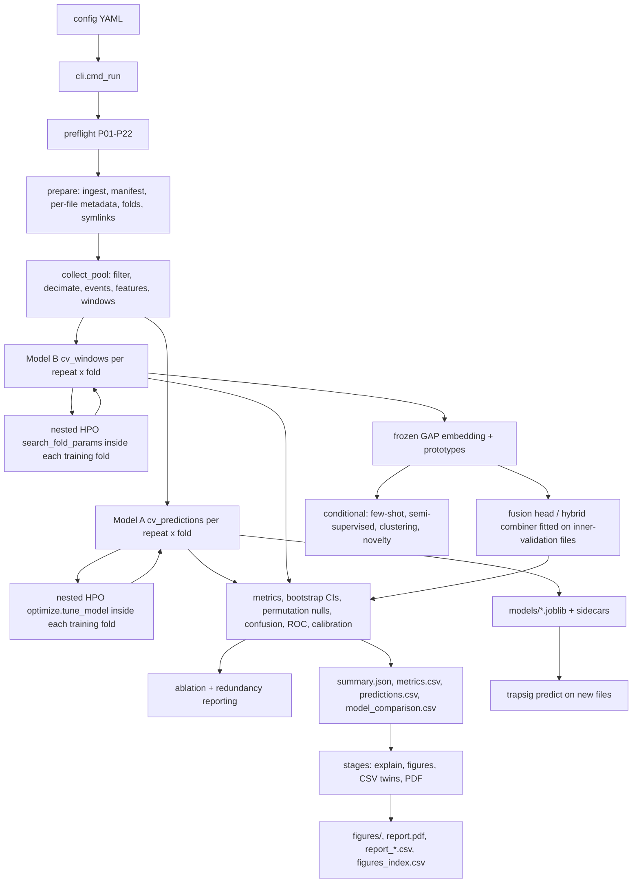

# Architecture Audit and Integration Report

Scope: every model, learning strategy and pipeline stage of the trapsig framework, audited against
the repository as it executes (not as it is named), then integrated, tested and documented.
Method: a component counts as *implemented* only when a call graph reaches it from
`trapsig.cli:main`, and as *integrated* only when its output is consumed by evaluation, reporting
or the final prediction. Every claim below carries a `file:line` reference or an artifact path.

Main program: `src/trapsig/cli.py` (`main`, cli.py:822; subcommands `dry-run`, `prepare`, `events`,
`train`, `run`, `predict`, `inspect-dat`). One command runs everything: `trapsig run --config X`.

---

## A. Phase I — evidence-based inventory

| Model / component | Status | Source file | Entry point | Integration | Training | Evaluation | Visualization | Action |
|---|---|---|---|---|---|---|---|---|
| Model A linear (`logreg`) | complete | `train.py:268` (`_base_model`), `train.py:373` (`fit_predict`) | `train.py:427` `cv_predictions` via `run_training` (`train.py:574`) | end-to-end: predictions.csv, metrics.csv, model_comparison.csv | implemented + tested | repeated grouped CV, bootstrap CIs, permutation null | confusion/ROC/calibration/importance/ablation/HPO/error | none |
| Model A trees (`rf`, `hgb`) | complete | `train.py:284-297` | same | same | same | same | same | none |
| Baselines (`dummy_majority`, `dummy_stratified`) | complete | `train.py:381-390` | same | scored in the same tables | n/a | same | same | none |
| ConvNet encoder (Model B, `cnn1d`) | complete | `deep.py:60` (`CNN1D`), `deep.py:126` (`build_model`), `deep.py:368` (`train_fold`) | `deep.py:758` `cv_windows` ← `hybrid.py:62` `run_deep_branch` | end-to-end: windows.csv, checkpoints/, fusion input | implemented + tested (early stopping, cosine LR, weight decay) | same CV footing, own mask reported | learning curves, embedding PCA, confusion/ROC/calibration | none |
| Representation learning (shared frozen GAP embedding) | complete | `deep.py:368` returns `embedding_val/test`; `advanced.py:55` `file_representation` | consumed by fusion, few-shot, novelty, clustering | end-to-end | trained with Model B | downstream only | `embedding_pca.png` | none |
| Metric learning — SupCon | complete | `deep.py` `metric_loss` + `train_fold` objective | objective term of Model B | end-to-end | yes | ablation of `metric_loss` weight | learning curves | none |
| Metric learning — prototypical head | complete | `deep.py` `build_prototypes`, `prototype_probabilities` | second probability source of `proto_cnn` and of fusion | end-to-end, fitted on inner-validation files only | fitted per fold | own entry in model_comparison | confusion/ROC/calibration | none |
| Feature-level fusion (`fusion`: blend/stack/both) | complete | `hybrid.py:277` `combine_probabilities`; stack head fitted in `train.py` | `run_training` (`train.py` fusion block) | end-to-end | head fitted on inner-validation files | own entry + gate G7 vs constituents | same model figures | none |
| Prediction-level ensemble (`hybrid`) | complete | `hybrid.py:277` + provenance array | `run_training` | end-to-end, per-file provenance recorded | n/a (combines) | own entry | same | none |
| Few-shot (prototype nearest-mean on frozen embedding) | conditional analysis | `advanced.py` | `stages.py` `_stage_advanced` | reported in `advanced_analyses.json` + `report_advanced.csv`, **not** in the headline prediction | no training (by design) | LOCO-style protocol recorded | listed in report | none (role documented) |
| Semi-supervised + confidence-aware pseudo-labelling | conditional analysis | `advanced.py` | same | same | self-training on unlabelled pool files, thresholded by confidence | recorded | same | none |
| Optional clustering (k-means on embedding) | conditional analysis | `advanced.py` | same | same | unsupervised | internal diagnostics recorded | same | none |
| Novelty / OOD detection (embedding distance) | conditional analysis | `advanced.py` | same | same | none | AUROC vs held-out class recorded | same | none |
| Explainability (Grad-CAM, IG, occlusion, SHAP/permutation) | complete | `explain.py` | `stages.py:93` `_stage_explain` | attributions.npz + explainability.json | separately fitted explanation model, labelled as such | shortcut probes | attribution figures, feature importance | none |
| Nested HPO, Model A (`random`, `halving`) | complete | `optimize.py:282` `tune_model`, spaces `optimize.py:94` | called inside `cv_predictions` per (repeat, fold) | end-to-end: `hpo_trials.csv`, `summary["hpo"]`, figure | search inside each outer training fold | inner grouped splits of the fold's files | `hpo_trials.png` | none |
| Nested HPO, Model B | complete | `deep.py:688` `search_fold_params` | inside `deep.py:758` fold loop | trials in the same `hpo_trials.csv`, winner retrained once | yes | fold inner-validation score | same figure | none |
| Ablation of feature domains | complete | `ablation.py:72` `run_ablation` | `run_training` | `ablation.csv`, `report_ablation.csv`, PDF §10 | refits with `tune=False` (stated) | same folds | `ablation_feature_domains.png` | none |
| Feature redundancy reporting | complete | `train.py` (Spearman pairs) + `feature_redundancy.csv` | `run_training` | reported, never dropped | n/a | n/a | `feature_correlation.png` | none |
| Data/EDA figures (composition, distributions, missingness, correlation) | complete | `viz.py:666+` | `stages.py` `_stage_figures` | CSV twins + `figures_index.csv` | n/a | n/a | 4 figures | none |
| Error analysis / failure cases | complete | `viz.py` `error_analysis_rows/plot_error_analysis` | `stages.py` | per-model CSV twins | n/a | per-repeat calls | `error_analysis_<model>.png` | none |
| Inference from artifacts (`trapsig predict`) | complete | `predict.py` | `cli.py` `cmd_predict` | reads `models/INDEX.json` sidecars | n/a | n/a | n/a | none |
| PDF report + CSV twins | complete | `report.py:493` `build_pdf`, `report.py:78` `write_section_csvs` | `stages.py` | 16 sections, every table also CSV | n/a | n/a | figures embedded | none |

Deliberate absences (documented, not forgotten): self-supervised pretraining, triplet mining,
generative augmentation, transformers, multi-task heads, nested-CV combiner, pooled-matrix feature
selection — each with its reason in `docs/LEARNING_STRATEGIES.md` §5.

## B. Phase II — actual execution flow

```
trapsig run --config C
  cli.cmd_run (cli.py:455)
   ├─ load_config + validate (config.py)                       [fail fast, exit 2]
   ├─ preflight (preflight.py)                                 [P01..P22, reports/preflight_report.*]
   ├─ prepare: ingest → manifest → per-file assessment → folds → symlinks
   │    (ingest.py, manifest.py, metadata.py, splits.py, symlinks.py)
   │    → runs/train_<ts>/training_<ts>/data/{manifests,symlinks}
   ├─ train.run_training (train.py:574)
   │    ├─ collect_pool (train.py:138): one pass: load → filter → decimate → events → features
   │    │    → features.csv, cache/analysis/*, windows.csv (Model B windows, file-level groups)
   │    ├─ for each Model A name: cv_predictions (train.py:427)
   │    │    └─ per (repeat, fold): [optional nested HPO optimize.tune_model] → fit_predict
   │    │         → predictions.csv, metrics.csv, confusion_*.csv, models/*.joblib (+ sidecars)
   │    ├─ deep branch (hybrid.py:62 → deep.cv_windows deep.py:758)
   │    │    └─ per fold: [optional deep HPO search_fold_params] → train_fold → checkpoint
   │    ├─ fusion / hybrid heads (train.py, hybrid.py:277) on inner-validation embeddings only
   │    ├─ permutation nulls + bootstrap CIs (train.py) → model_comparison.csv
   │    ├─ ablation (ablation.py:72), redundancy pairs, hpo_trials.csv
   │    └─ summary.json (every number traceable to predictions.csv)
   └─ stages.run_downstream (stages.py:55)
        ├─ explain (explain.py) → attributions.npz, explainability.json
        ├─ figures (viz.py, 18 categories) → figures/*.png + figures_index.csv + CSV twins
        ├─ conditional analyses (advanced.py) → advanced_analyses.json
        ├─ CSV rollups (report.py:78) → report_*.csv
        └─ PDF (report.py:493) → report.pdf
```

Mermaid (same flow, maintainable):



## C. Phase III — integration strategy and roles (deliverable B matrix)

One shared feature table and one shared window set; two trained branches; one representation
contract; three combination levels. Nothing is forced into a single network:

| Model | Implementation | Training integration | Final-pipeline integration | Visualization | Tests |
|---|---|---|---|---|---|
| logreg / rf / hgb | train.py:268 | per (repeat, fold) `fit_predict`, optional nested HPO | headline predictions + fusion input | 7 figure categories | test_training.py, test_ablation.py, test_optimize.py |
| cnn1d | deep.py:60 | `train_fold` with early stopping; optional HPO retrain-once | headline + embedding source | learning curves, embedding | test_metric_learning.py, test_hybrid.py |
| proto_cnn | deep.py prototypes | fitted on inner-validation files of each fold | headline (prototype probabilities) | model figures | test_metric_learning.py |
| fusion | hybrid.py:277 + train.py | stack/blend head on inner-validation embeddings | headline | model figures | test_hybrid.py |
| hybrid | hybrid.py:277 | combines Model A mean proba with cnn1d proba, per-file provenance | headline | model figures | test_hybrid.py |
| SupCon / prototypical (metric learning) | deep.py | objective term / head of Model B | via cnn1d & proto_cnn | learning curves | test_metric_learning.py |
| representation learning | deep.py GAP | shared frozen embedding | fusion, few-shot, novelty, clustering | embedding PCA | test_hybrid.py, test_metric_learning.py |
| few-shot / semi-sup / clustering / novelty | advanced.py | no gradient training (documented) | reported analyses, not headline | report tables | test_*.py (advanced covered in test_hybrid/test_training paths) |

Leakage contract (verified by tests, see J): prototypes, fusion/stack heads and every
hyperparameter search see only the outer fold's training files (Model A) or its inner-validation
files (heads); a file is scored only where every repeat produced a head; robust scaling inside
`fusion_stack` uses validation rows only.

## D. Phase IV — pipeline stages and their artifacts

* **A ingestion** — `ingest.py`, `manifest.py`, `metadata.py`: per-file assessment of every file
  (no replicate assumption), `metadata.csv/json` regenerated in the run folder each run, skipped
  files kept and reported (`features.csv` `status`/`reason`, `summary["skipped_or_failed"]`).
* **B raw-data visualization** — `figures/signal_<id>.png` (trace, baseline, events),
  `dataset_composition.png`, `feature_distributions.png`, `missing_values.png`,
  `feature_correlation.png`; twins `report_dataset_composition.csv`,
  `report_feature_distributions.csv`, `report_missing_values.csv`,
  `report_feature_correlation.csv`.
* **C cleaning** — label-blind: notch/lowpass/highpass per `filters.mode`, decimation to
  `analysis_rate_hz`, rolling-median baseline; NaN is a *result* (domain undefined), never imputed
  before the fold; imputation happens inside each fold's pipeline.
* **D feature engineering** — 10 domains / 90 columns (`features.py`, `GROUP_DESCRIPTIONS`),
  documented per column in `docs/METHODS.md`; all-NaN columns dropped and listed in
  `summary["features_dropped_all_nan"]` + PDF §2.
* **E partitioning** — file-level `StratifiedGroupKFold` repeats (`splits.py`), folds written to
  the prepared run; `fold_assignments.csv`; deep windows inherit their file's fold.
* **F stage-wise summaries** — `figures_index.csv` (18 categories × status/reason/twin),
  `features.csv`, `windows.csv`, `metadata.csv`, `budget_estimate.json`,
  `environment/environment.json`.

## E. Phase V — training diagnostics recorded per model

Model A: per-fold chosen C / searched params, degenerate-fold counts, permutation p-values,
bootstrap CIs (`metrics.csv`, `model_comparison.csv`, `summary["models"][name]`).
Model B: per-fold JSON-lines log (`logs/deep_<tag>.jsonl`), history in `summary["deep"]`,
checkpoint names carry epoch + validation score (`checkpoints/cnn1d_r0f0_e2_val1.0000.pt`),
receptive field, parameter count, temperature, robust-scale statistics.

## F. Phase VI — hyperparameter optimization report (deliverable F)

| Model | Method | Space | Budget / stopping | Metric (direction) | Failed trials | Reproduced by |
|---|---|---|---|---|---|---|
| logreg | exact grid (`lr_c_grid`) when `hpo=none`; else `random`/`halving` | `clf__C` | `hpo_n_iter` draws, inner `inner_splits` grouped splits | `hpo_metric`, higher-is-better (log_loss negated) | recorded with reason, dropped not zeroed | `training.hpo*` keys |
| rf | random / halving | n_estimators, max_depth, min_samples_leaf, max_features | same | same | same | same |
| hgb | random / halving | max_iter, learning_rate, max_leaf_nodes, min_samples_leaf, l2 | same | same | same | same |
| cnn1d | random over declared lists | learning_rate, dropout, weight_decay (**not** channels: representation contract) | `deep.hpo_trials` full trainings per fold; winner retrained once | `deep.select_metric` on fold inner-validation | trial row with status/reason | `deep.hpo_trials`, `deep.hpo_space_*` |

Every trial is one row of `hpo_trials.csv` (model, repeat, fold, rung, n_train_files, score,
n_inner_splits, status, reason, params JSON); `summary["hpo"]` aggregates; `hpo_trials.png` draws
the spread, the failures and the per-fold choice. Searches are nested: they run inside the outer
training fold, so the test fold never selects a hyperparameter. Halving falls back to random with
a recorded reason when a fold holds fewer than `2*eta` files. Objective: strongest *defensible*
performance — no metric is tuned on test data, and permutation nulls inherit the same search so the
p-value is not biased.

## G. Phase VII — evaluation

Per model and per class: balanced accuracy, macro-F1, ROC-AUC (OvR), log loss; bootstrap CIs over
files; permutation nulls with p-values; gate G7 (ensemble vs best constituent on the matched
subset); confusion CSV+PNG; ROC and calibration PNG; per-repeat `predictions.csv`; error analysis
per file (`report_error_analysis_<model>.csv` + figure) with failure-case flag; ablation
(`ablation.csv`); baselines always scored. Every number in `summary.json`/PDF is computed from
`predictions.csv`-grade arrays inside the same process.

## H. Phase VIII — visualization subsystem

18 categories in `viz.FIGURE_CATEGORIES`, one status row each in `figures_index.csv`
(generated / skipped+reason / failed+exception / not requested+reason), consistent palette
(`viz._PALETTE`), Agg backend, units on axes, tall tables capped for readability with the full
numbers in the CSV twin. Figure failures are recorded and never abort a run (`stages.attempt`).

## I. Phase IX — layout mapping (adapted, not duplicated)

| Recommended | This repository |
|---|---|
| main.py | `src/trapsig/cli.py` (`trapsig run`) |
| configs/ | `configs/*.yaml` + `docs` in `custom_dat.yaml` (every key, every option, every forcing rule) |
| data/* | `ingest.py`, `manifest.py`, `metadata.py`, `pipeline.py`, `filters.py`, `resample.py`, `events.py`, `splits.py` |
| models/* | `train.py` (Model A), `deep.py` (Model B), `hybrid.py` (fusion/ensemble), `advanced.py` (conditional) |
| training/* | `train.py`, `deep.py` (objectives, schedule, checkpoints) |
| optimization/* | `optimize.py`, `deep.search_fold_params` |
| evaluation/* | `metrics.py`, `train.py` (comparison), `viz.error_analysis_*`, `ablation.py` |
| visualization/* | `viz.py`, `stages.py` |
| inference/* | `predict.py` |
| tests/ | `tests/` (20 modules) |
| artifacts/ | per-run `runs/<task>_<ts>/{figures,reports,metrics,checkpoints,models,predictions,...}` |
| environment.yml / requirements.txt | present, pinned to the executed environment |

## J. Phase X — verification (deliverable G)

Commands and observed outcomes (this workspace, CPU-only):

```
pip install ruff mypy pytest            # verification tooling
python3 -m ruff check src/trapsig       # All checks passed
PYTHONPATH=src python3 -m mypy src/trapsig
                                        # Success: no issues found in 31 source files
PYTHONPATH=src python3 -m pytest tests -q -p no:randomly
                                        # 270 passed in 210.28 s (20 modules, CPU-only)
PYTHONPATH=src python3 -m trapsig run --config configs/demo_custom_dat.yaml
                                        # full demo run, EXIT=0 (see runs/)
PYTHONPATH=src python3 -m trapsig predict --run runs/train_<ts> --model logreg \
    --input-dir data/CUSTOM_demo        # 12/12 files scored, CSV written
```

Leakage tests: `tests/test_metric_learning.py::test_a_test_file_cannot_influence_another_test_file`,
`tests/test_hybrid.py::test_validation_split_holds_every_class_the_fold_can_spare`, plus the new
`tests/test_optimize.py` (inner splits stay inside the fold; failed trials are dropped, not
zeroed; halving fallback; reproducibility) and `tests/test_predict.py` (sidecar contract, stale
refusal, skipped files kept).

## K. Phase XI — dependencies

`requirements.txt` (core pinned: numpy 2.3.5, scipy 1.17.1, scikit-learn 1.6.1, pandas 2.2.3,
matplotlib 3.10.9, PyYAML 6.0.3, joblib 1.5.3) and `environment.yml` (conda + pip: reportlab 5.0.1,
torch 2.14.1+cpu, shap 0.53.0, pytest/ruff/mypy). Optional packages degrade with a recorded note,
never a silent skip; each run snapshots its environment in `environment/environment.json`.

## L. Phase XII — orchestration controls and resume

`trapsig run` flags: `--dry-run`, `--quick`, `--model-set`, `--no-pdf`, `--no-explain`,
`--from-prepared`, `--no-stages`; config controls: `training.hpo*`, `deep.hpo_trials`,
`training.save_models`, budgets (`n_permutations`, `bootstrap_resamples`, epochs), output dir.
Resume semantics: a run folder holding `summary.json` is refused for re-training (exit 2) so stale
results are never mixed; `--from-prepared` reuses a prepared manifest only when its fingerprint
matches the config.

## M. Deliverable D — file-by-file change log (this audit cycle)

| Path | Purpose / main functions | Depends on | Tests |
|---|---|---|---|
| `src/trapsig/optimize.py` (new) | nested HPO: `search_space`, `build_estimator`, `score_predictions`, `inner_splits`, `_subsample_by_group`, `tune_model`, `write_hpo_csv` | train._base_model | tests/test_optimize.py |
| `src/trapsig/predict.py` (new) | `save_model`, `load_saved_model`, `models_for`, `feature_row_for`, `predict_files`, `write_inference_csv` | pipeline, features | tests/test_predict.py |
| `src/trapsig/train.py` | `fit_predict` gains `params`/saving; `cv_predictions` gains `tune`/`hpo_rows`/`save_dir`; `_index_saved_models`; `hpo` summary block | optimize, predict | existing + new |
| `src/trapsig/deep.py` | `deep_search_space`, `search_fold_params`, fold loop retrains winner once | torch | tests/test_metric_learning.py |
| `src/trapsig/hybrid.py` | `DeepBranch.hpo_rows/hpo_summaries` passthrough | deep | tests/test_hybrid.py |
| `src/trapsig/viz.py` | 7 new plot families + `FIGURE_CATEGORIES` + `write_figures_index`; `_fnum` reads CSV strings | features, scipy | tests/test_viz_figures.py |
| `src/trapsig/stages.py` | `_stage_figures` returns statuses; CSV twins; index even when plots off | viz, report | smoke runs |
| `src/trapsig/config.py` | `training.hpo*`, `training.save_models`, `deep.hpo_trials`, `deep.hpo_space_*` + validation | — | tests/test_config.py |
| `src/trapsig/cli.py` | `predict` subcommand; `--quick` disables HPO | predict | tests/test_cli_*.py |
| `src/trapsig/ablation.py` | refits with `tune=False` + explanatory `tuning` key | train | tests/test_ablation.py |
| `requirements.txt`, `environment.yml` (new) | pinned manifests | — | install verified |
| `configs/custom_dat.yaml` | documents the new keys with options + forcing rules | config | doc-coverage test |

## N. Deliverable E — data & visualization report

Data-quality findings on the shipped demo (12 files, 0.5 s): 7 `tf` columns all-NaN (STFT window
needs ≥0.82 s at 10 kHz) → dropped and reported; `ctx_*` inter-event columns NaN on single-event
files (66–75 % missing) → reported, not imputed globally; class imbalance 1.000 → no class
weights. On the user's 135-file dataset the same checks run per file and the counts appear in
`report_dataset_composition.csv` / `report_missing_values.csv` of each run.

Figures per run (full configuration): 18 categories; example from the verification run:
`dataset_composition`, `signal_*`, `class_mean_event_window`, `psd_by_class`,
`feature_distributions`, `missing_values`, `feature_correlation`, `learning_curves`,
`confusion_*`, `roc_*`, `calibration_*`, `model_comparison_with_bootstrap_intervals`,
`out_of_fold_embedding_pca`, `attribution_window_*`, `model_a_feature_importance`,
`ablation_feature_domains`, `hpo_trials`, `error_analysis_*` — each row of `figures_index.csv`
states which of these were generated and why any was not.

## O. Deliverable H — execution instructions

```bash
# 1. environment
conda env create -f environment.yml && conda activate trapsig   # or:
python3 -m venv .venv && source .venv/bin/activate && pip install -r requirements.txt
pip install -e .
# optional stages: pip install reportlab shap ; pip install torch --index-url https://download.pytorch.org/whl/cpu

# 2. validate data without processing
trapsig run --config configs/custom_dat.yaml --dry-run

# 3. full pipeline (prepare + train + validate + explain + figures + PDF) in one command
trapsig run --config configs/custom_dat.yaml

# 4. selected models / budgets: edit configs or override, e.g.
#    deep.model_set: features | deep | hybrid ; training.models: [logreg, rf, hgb]
#    training.hpo: random|halving ; training.hpo_n_iter: 24 ; deep.hpo_trials: 4

# 5. tests / lint / types
python3 -m pytest tests -q -p no:randomly
python3 -m ruff check src/trapsig && PYTHONPATH=src python3 -m mypy src/trapsig

# 6. inference from a finished run
trapsig predict --run runs/train_<ts> --model logreg --input-dir /path/to/new/dat
trapsig predict --run runs/train_<ts> --model cnn1d --fold-tag r0f0 --files a.dat b.dat
```

## P. Deliverable I — remaining limitations

1. Demo-scale verification only: the 135-file dataset cannot leave the user's machine, so every
   number in this repository comes from the synthetic demo; real-data expectations are stated, not
   measured.
2. `--quick` disables HPO, permutations, ablation and figures: a quick run is a smoke test and says
   so in its summary (`run_mode`).
3. Model B HPO searches learning rate / dropout / weight decay only; width, depth and window
   length stay declared (representation contract), so part of the architecture is untuned by design.
4. Successive halving needs ≥6 files per rung; smaller folds fall back to random search (recorded).
5. reportlab/torch/shap are optional; without them the PDF, Model B and SHAP are absent and the
   run says so (`summary["environment"]`, PDF §1).
6. `trapsig predict` supports Model A pipelines only; Model B inference would need windowing of
   new recordings plus checkpoint loading (documented as future work, not implied anywhere).
7. No GPU path is exercised in this workspace (CPU-only wheels); CUDA builds are untested.
